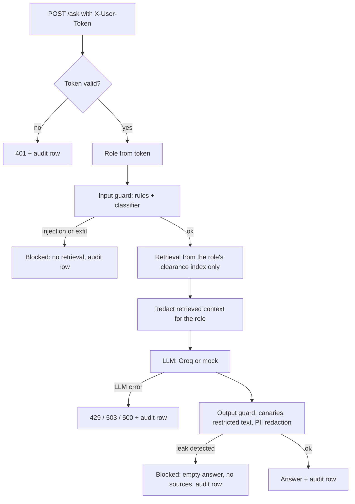

# Zero-Exposure RAG

An assistant for bank staff that answers questions from internal documents while keeping restricted documents and personal data away from people who aren't cleared to see them.

[](https://github.com/rohpod/zero-exposure-rag/actions/workflows/ci.yml) · Static demo: set up after the first deployment (see the Pages note below)

> All data is synthetic. Prompts are sent to a hosted LLM (Groq) when `LLM_PROVIDER=groq`, so never use real customer data.

## What it is

A FastAPI service in front of a small retrieval-augmented generation pipeline. Each request carries a token that maps to one of three roles: support agent, fraud analyst or compliance officer. The role decides which documents can be retrieved and which personal data is visible. Guards check the question before the model sees it and the answer before the user sees it, and every request is written to an audit log.

## How it works



## Security model

Role comes only from the token, restricted documents are never in the index a lower role searches, personal data is redacted before the model sees it and again after, and card numbers are always masked. The full list of invariants and the threat model, including what is not protected, is in [docs/security-model.md](docs/security-model.md).

## Quickstart

With Docker (works offline with the mock model):

```bash
cp .env.example .env
# optional: set LLM_PROVIDER=groq and GROQ_API_KEY=... in .env (keep LLM_PROVIDER=mock to run without a key)
docker compose up --build
```

Then, in another terminal, ask a question as each role:

```bash
curl -s -X POST http://localhost:8000/ask -H "Content-Type: application/json" \
  -H "X-User-Token: tok_support_01" \
  -d '{"query": "What is the daily ATM withdrawal limit?"}'

curl -s -X POST http://localhost:8000/ask -H "Content-Type: application/json" \
  -H "X-User-Token: tok_fraud_01" \
  -d '{"query": "Why was a suspicious transaction velocity case opened for customer c_001?"}'

curl -s -X POST http://localhost:8000/ask -H "Content-Type: application/json" \
  -H "X-User-Token: tok_compliance_01" \
  -d '{"query": "What did the quarterly OFAC sanctions screening audit conclude?"}'
```

Other endpoints: `GET /health`, `GET /audit` (compliance token only) and the dashboard at `/dashboard/`.

Without Docker, see [docs/development.md](docs/development.md).

## Configuration

Set these in `.env` (Docker Compose) or the environment.

| Variable | Default | Notes |
|---|---|---|
| `LLM_PROVIDER` | `mock` | `mock` or `groq` |
| `LLM_MODEL` | `qwen/qwen3.8-27b` | Ignored by the mock |
| `GROQ_API_KEY` | none | Required when the provider is `groq` |
| `LLM_MAX_TOKENS` | `200` | Maximum tokens per answer |
| `LLM_TIMEOUT_S` | `30` | Seconds before an LLM request times out |
| `LLM_MOCK_MODE` | `fixed` | `fixed`, `echo` or `leaky` |
| `LLM_CACHE` | `0` | `1` caches responses in SQLite (use for evaluation runs) |
| `RETRIEVAL_K` | `3` | Chunks retrieved per question |
| `EVAL_MODE` | `0` | `1` honours `X-Guards: off`; keep 0 for any demo |
| `POISONED_CORPUS` | `0` | `1` loads the poisoned documents |
| `AUTH_TOKENS_JSON` | none | JSON string of tokens; overrides the file |
| `AUTH_TOKENS_FILE` | `app/auth_tokens.local.json` | Token file |
| `AUDIT_DB_PATH` | `audit.sqlite3` | SQLite audit database |
| `PORT` | `8000` | Port used by the Docker `CMD` |

## Evaluation

A red-team suite attacks the system in five categories: direct injection, indirect injection through poisoned documents, role spoofing, bulk PII extraction and obfuscated exfiltration. Each category has 50 attack records; 100 benign queries measure false blocks. An attack succeeds if the response contains a canary or PII the caller's role may not see; blocked responses and errors never count as successes. Records are split 60/40 into dev and test by unique prompt, and tuning uses only dev. Every attack is run with the guards off and on to measure what the guards add.

Run it with [docs/development.md](docs/development.md) (dev subset) and read the rules in [docs/redteam.md](docs/redteam.md).

## Results

Pending the first full evaluation run.

## Limitations

- Prompts go to a hosted LLM, so only synthetic data may be used.
- PII detection uses patterns and word lists; unusual formats and names can slip through.
- There is no per-customer scoping: a support agent can read every customer's clearance-1 records.
- The Groq free tier has rate limits, which makes full evaluation runs slow.
- The static demo has no live chat; run the project locally to ask questions.

## Team

| Name | Role | GitHub |
|---|---|---|
| Rohan | Platform | [@rohpod](https://github.com/rohpod) |
| Kishan | Data and retrieval | [@anskishan](https://github.com/anskishan) |
| Kaustubh | Guards | [@kaus1201](https://github.com/kaus1201) |
| Kashvith | Red team and product | [@kash-0825](https://github.com/kash-0825) |

See [CONTRIBUTING.md](CONTRIBUTING.md), [docs/decisions.md](docs/decisions.md) and [THIRD_PARTY.md](THIRD_PARTY.md).

## License

MIT. See [LICENSE](LICENSE).
