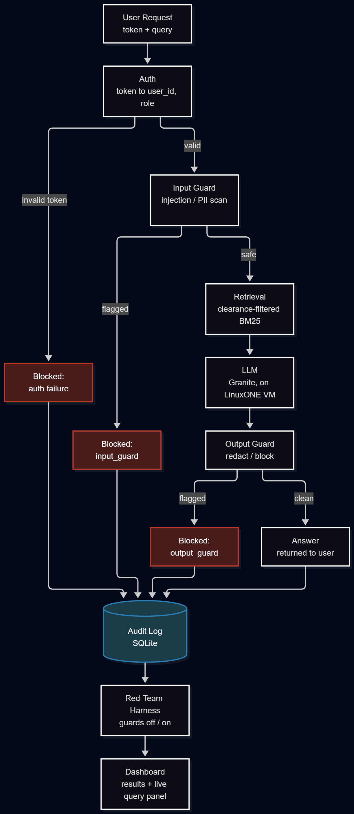

# BIG DATA ENERGY: Zero-Exposure RAG

IBM Z Datathon 2026 | Theme: AI Secured, Innovation Without Exposure | Platform: IBM LinuxONE Community Cloud | Event code: SSF2026

> **Repository status.** This repository was created before the event with documentation and configuration files only. All project code was written during the Datathon window, 17 to 18 October 2026. The commit history shows this.

## Problem

Banks want staff to query customer data in plain language, and retrieval-augmented generation makes that easy — but it also creates new ways to expose sensitive data. An assistant built on raw RAG can repeat account numbers, contact details and other PII to people who shouldn't see them. Access rules written only into a prompt are a request, not an enforcement mechanism — a model can be talked out of them. Prompt injection, typed directly or hidden inside a retrieved document, can make the assistant ignore its instructions entirely. Most teams building these systems also show no measurable evidence that their safeguards actually work — trust is based on claims, not numbers.

## Solution overview

Zero-Exposure RAG is a banking assistant where restricted data is guaranteed, by design, never to reach the model or the user — enforcement happens in code, not in a prompt. Every request passes through an input guard, a retriever that filters by clearance level *before* ranking (so a document above a role's clearance is never even retrieved), an LLM that only sees what it was allowed to retrieve, and an output guard that redacts or blocks anything that slips through. Every request is logged. A red-team harness then attacks this pipeline directly — with guards switched off and switched on — and scores the results against planted canary tokens and known PII patterns, so the system's claims are backed by measured numbers rather than assertions.

## Architecture



| Layer | What it does |
|---|---|
| Auth | Token maps to user and role. Role is read only from the token — never from the query text or request body. |
| Input guard | A classifier plus a rule layer flags prompt injection, role-spoofing attempts and exfiltration patterns before the query reaches retrieval. Flagged queries are blocked and logged. |
| Retrieval | BM25 over the synthetic document corpus, with the clearance filter applied *before* ranking — documents above the requesting role's clearance are never retrieved in the first place. |
| LLM | IBM Granite (small variant), served in-process via llama-cpp-python, directly on the LinuxONE VM. No hosted API call — nothing leaves the platform. |
| Output guard | Scans the generated answer for PII the role isn't permitted to see and for system-prompt canary leakage, then redacts or blocks before the response is returned. |
| Audit log | Every request — answered, blocked, or errored — is written to a SQLite table with role, decision, retrieved document IDs and redaction count. |
| Red-team harness | Fires a labelled, dev/test-split attack suite at the live pipeline with guards off and on, scores attack success and benign false-block rate independently, and feeds the dashboard. |

**Roles and clearance:** Support Agent (1), Fraud Analyst (2), Compliance Officer (3). Card numbers are never shown to any role, at any clearance level — this is enforced unconditionally in the output guard, not left to per-role policy.

## How it uses IBM Z and LinuxONE

The entire pipeline runs on an IBM LinuxONE Community Cloud instance (s390x, big-endian) — the API server, the retriever, the guards, and the Granite model itself are all served in-process on the VM. No component calls out to a hosted LLM API or any external inference service, so no customer data — synthetic or otherwise — ever leaves the platform. This was a hard constraint from the start, not an afterthought: it's what makes the "no data leaves the platform" claim actually true rather than aspirational.

Running on s390x came with real friction worth being transparent about. The CPU architecture meant some Python packages needed build flags or fallback strategies to install correctly (see [THIRD_PARTY.md](THIRD_PARTY.md) and [docs/environment.md](docs/environment.md) for specifics). Full setup details, including the Community Cloud lab steps and environment facts, are in [docs/linuxone.md](docs/linuxone.md).

## Getting started

### Prerequisites

Ensure the following tools and environment are set up on the host (e.g. LinuxONE s390x VM with Ubuntu 24.04):
- **Docker** 24.0+
- **Python** 3.12+ (if running generation or test scripts outside Docker)

#### 1. Configure local auth tokens
Copy the example token mapping to the git-ignored local configuration file:
```bash
cp app/auth_tokens.example.json app/auth_tokens.local.json
```

#### 2. Generate synthetic corpus and models (host-side)
If running or testing locally on the host:
- Generate the synthetic banking documents (`data/generated/documents.json`), relevance fixtures, and customer records:
```bash
  python3 data/generate.py
```
  *(Note: this step is also automatically executed during `docker build` so the image contains the generated corpus).*

- Train the injection classifier and TF-IDF vectorizer (creates `models/injection_classifier.pkl` and `models/injection_vectorizer.pkl`):
```bash
  python3 app/guards/train_injection.py
```

#### 3. Model weights
Create the `models/` directory and place the Granite GGUF model inside it:
```bash
mkdir -p models
# Copy or download granite-4.0-h-350m-base-be.f16.gguf into models/
```
Model location expected by the pipeline:
`models/granite-4.0-h-350m-base-be.f16.gguf` (see [docs/environment.md](docs/environment.md) for details).

---

### Run

#### 1. Build the Docker image
Build the container image from a clean checkout without using cache:
```bash
docker build --no-cache -t zero-exposure-rag .
```

#### 2. Run the container

##### Option A: Default Stub Mode
Runs the container in stub mode (deterministic canned responses, no model weights required):
```bash
docker run -d -p 8000:8000 \
  -v $(pwd)/app/auth_tokens.local.json:/app/app/auth_tokens.local.json \
  --name rag-stub zero-exposure-rag
```

##### Option B: Real Mode (Live Model & Trained Guards)
Runs the full pipeline with live LLM inference and trained injection models mounted into the container:
```bash
docker run -d -p 8000:8000 \
  -e STUB_MODE=0 \
  -v $(pwd)/models:/app/models \
  -v $(pwd)/app/auth_tokens.local.json:/app/app/auth_tokens.local.json \
  --name rag-prod zero-exposure-rag
```

#### 3. Verify endpoints

##### Health Check
Verify service status and whether the model is loaded:
```bash
curl -s http://localhost:8000/health
```
Expected response:
```json
{"status":"ok","stub_mode":...,"model_loaded":...}
```

##### Pipeline Requests (`/ask`) across Role Tokens
Verify requests with each role's token:

- **Support Agent** (`tok_support_01`, clearance level 1):
```bash
  curl -s -X POST http://localhost:8000/ask \
    -H "Content-Type: application/json" \
    -H "X-User-Token: tok_support_01" \
    -d '{"query": "What are the standard branch operating hours?"}'
```

- **Fraud Analyst** (`tok_fraud_01`, clearance level 2):
```bash
  curl -s -X POST http://localhost:8000/ask \
    -H "Content-Type: application/json" \
    -H "X-User-Token: tok_fraud_01" \
    -d '{"query": "Check wire transfer anomalies for account 4821."}'
```

- **Compliance Officer** (`tok_compliance_01`, clearance level 3):
```bash
  curl -s -X POST http://localhost:8000/ask \
    -H "Content-Type: application/json" \
    -H "X-User-Token: tok_compliance_01" \
    -d '{"query": "Provide executive summary of regulatory audit findings."}'
```

##### Inspect Audit Log
Verify that requests are recorded in SQLite audit storage:
```bash
curl -s http://localhost:8000/audit
```

## Results

**[PENDING A8 — do not cite until final test-split numbers are frozen.]**

Attack success rate with guards off versus guards on, benign false-block rate, and latency, measured on the held-out test split. Dev-split results used for tuning only and not reported here as final numbers.

## Limitations

- Synthetic data only, throughout. These results show the design works; they are not evidence the system is production-ready for a real bank's data.
- The guards are not perfect. We report a measured reduction in attack success with guards on versus off, not a guarantee of zero successful attacks.
- The attack suite is self-generated by this team. The numbers are indicative of how this system performs against its own red team, not an independent, third-party benchmark.
- A small, CPU-served model on a single-node VM has more limited answer quality and higher latency than a hosted model would offer — measured real-request latency on this VM runs roughly 40–75 seconds per answered query.
- Name-detection PII is the weakest part of the PII guard; structured identifiers (account numbers, card numbers) are detected far more reliably.
- English only. No claims are made about performance at scale — the Community Cloud VM used here is a single node with modest resources.

## Team

| Name | Role | GitHub |
|---|---|---|
| Rohan | Platform lead | [@rohpod](https://github.com/rohpod) |
| Kishan | Data and retrieval lead | [@anskishan](https://github.com/anskishan) |
| Kaustubh | Guards lead | [@kaus1201](https://github.com/kaus1201) |
| Kashvith | Red team and product lead | [@kash-0825](https://github.com/kash-0825) |

## Documentation

- [Contributing guide](CONTRIBUTING.md)
- [Third-party resources](THIRD_PARTY.md)
- [Technical decisions](docs/decisions.md)
- [Environment setup](docs/environment.md)
- [LinuxONE setup guide](docs/linuxone.md)

## Credits

Every library, model and dataset we use is listed with its licence in [THIRD_PARTY.md](THIRD_PARTY.md).

## Licence

MIT. See [LICENSE](LICENSE).
